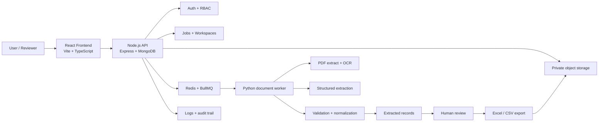

# DocuFlow AI architecture

## High-level system design

## Architectural principles

1. Separate the user-facing API from long-running processing.
2. Keep the Node.js server responsible for domain orchestration, auth, and metadata.
3. Use a dedicated Python worker for OCR, structured extraction, and validation logic.
4. Treat uncertain values as first-class data, never as silent placeholders.
5. Enforce workspace-level authorization on every document and job query.
6. Prefer signed upload URLs for large document transfers.

## Service boundaries

### Frontend

- Authentication screens and workspace switching
- Upload dashboard and job monitoring
- Review grids for extracted invoice data
- Export generation and analytics displays

### API server

- User registration and login
- Workspace membership and role checks
- Job creation and state transitions
- File metadata and audit records
- Storage integration and queue dispatch

### Python worker

- Digital PDF parsing and OCR
- AI extraction with structured output contracts
- Validation, confidence scoring, and anomaly detection
- Excel/CSV export preparation

## Data model direction

- `users`: personal account metadata and auth details
- `workspaces`: tenant-level grouping
- `workspaceMembers`: membership and role assignments
- `documents`: file metadata, checksum, status, storage refs
- `jobs`: batch metadata, status, retry info, processing timestamps
- `records`: extracted invoice record candidates
- `reviewActions`: human review edits and audit history
- `exports`: generated spreadsheet artifacts

## Deployment strategy

- Local development: Docker Compose with MongoDB, Redis, and storage emulation
- Staging: managed MongoDB Atlas, managed Redis, and private S3-compatible storage
- Production: containerized services behind a reverse proxy, with CI validation on every merge

## Security posture

- Secure, HTTP-only session cookies
- Role-based access control enforced in the backend
- Document access constrained by workspace membership
- File signature and MIME validation before import
- Auditable job history and explicit uncertainty states
